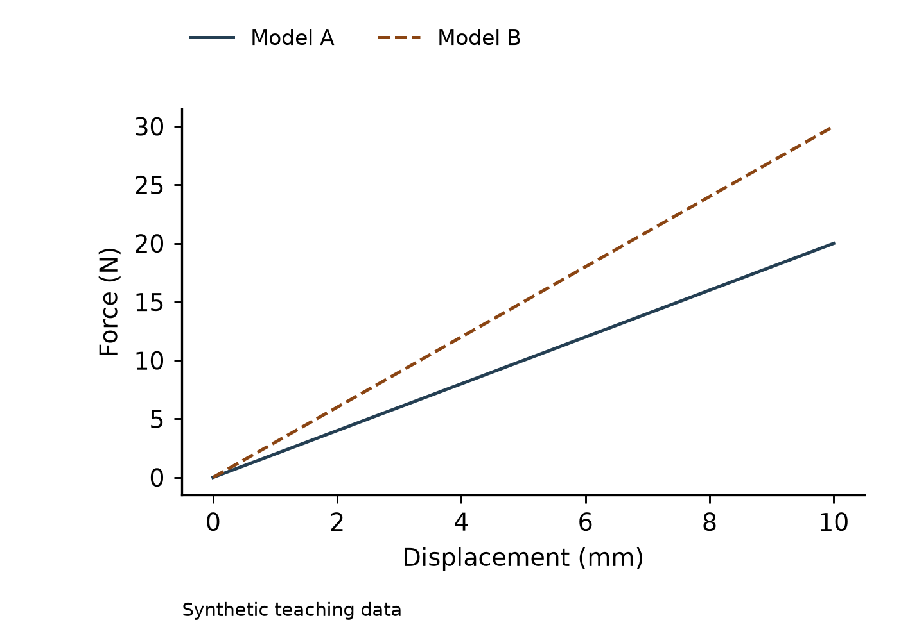

# 科研制图 Skill

本仓库提供scientific-figure-optimizer 0.2.2-local：根据明确来源和单位的CSV绘制可复现数据图，并通过本地参考案例检索、实际看图与规则提炼生成Figure Brief。这里的学习是运行时参考，不是模型训练。

## 当前能力

| 能力 | 当前范围 |
|---|---|
| 数据图 | 共用线性坐标的1—3条CSV曲线；保留所有数值、点数和点序 |
| 可编辑输出 | SVG文字与路径、PDF、PNG；交付数据/任务单/脚本/依赖与核查记录 |
| 导出后核查 | 重新读取文件，检查SVG逐点/顺序/参考线，PDF页面与字体，PNG尺寸/DPI及哈希 |
| 本地参考库 | 配置独立目录；按表达功能检索3—5例，实际查看后采用至少两个来源的规则 |
| 结构/机理/流程 | 支持检索与方案；本包尚无相应绘制后端 |
| Origin | 作者经代码审阅确认可用，本轮停止进一步复验；本包没有新增Origin可执行适配器 |



## 安装与运行

准备Python3.12和Git。本版使用scientific-figure-optimizer-v0.2.2分支，main与旧版分支保持原状。

```powershell
git clone --branch scientific-figure-optimizer-v0.2.2 https://github.com/zhilishiwubai/skill.git
cd skill/scientific-figure-optimizer
python --version
python -m venv .venv
.venv\Scripts\python.exe -m pip install -r requirements-lock.txt
.venv\Scripts\python.exe scripts/install_skill.py
.venv\Scripts\python.exe scripts/figure.py check examples/spring.json
.venv\Scripts\python.exe scripts/figure.py render examples/spring.json --out runs/my-first-figure
.venv\Scripts\python.exe scripts/figure.py verify runs/my-first-figure
```

已有Skill和输出目录会拒绝覆盖。依赖由虚拟环境提供；安装包不包含Python/Origin软件。更新Skill先备份旧目录，再运行安装器。

## 使用自己的数据

1. 准备UTF-8 CSV，确认列名、单位、来源、证据等级和使用权，保留原件。
2. 复制assets/brief-template.json，填写真实input、坐标、series和provenance。按任务写修改授权和验收问题，不沿用教学公式。
3. 用check、render、verify生成到新目录。查看彩色、最终尺寸及灰度预览，核对科学含义。自动PASS不代表科学批准。
4. 交付整个输出目录，按REPRODUCE.md重跑。不会自动平滑、删点、排序、重采样、改单位或移动参考边界。

## 连接本地图片库

安装包只提供模板和工具。论文、研究照片、案例卡和本地目录映射应由使用者独立配置，不随本仓库分发。

```powershell
.venv\Scripts\python.exe scripts/reference_library.py --library <本地库目录> index --deep
.venv\Scripts\python.exe scripts/reference_library.py --library <本地库目录> search --query "荷载位移对比" --function curves
.venv\Scripts\python.exe scripts/reference_library.py --library <本地库目录> read <case_id>
.venv\Scripts\python.exe scripts/reference_library.py --library <本地库目录> brief <request.json> --out <新任务目录>
```

实际打开图片查看后，才填写观察、预览哈希和采用规则。读取图片字节不等于看图。缺少图片库要说明限制；参考图片不能代替真实数据、试件映射或发表授权。旧索引在审核修改后通过index --deep重建为schema2。

## 按图型选择提示词

先读[分类说明](scientific-figure-optimizer/references/prompt-routing.md)，复制[共同模板](scientific-figure-optimizer/assets/prompts/common.md)，再补充实际图型。每份均有中文和English版本。

- [定量曲线](scientific-figure-optimizer/assets/prompts/curves.md)
- [结构、装配与剖面](scientific-figure-optimizer/assets/prompts/structure.md)
- [机理与阶段](scientific-figure-optimizer/assets/prompts/mechanism.md)
- [试验装置与加载边界](scientific-figure-optimizer/assets/prompts/apparatus.md)
- [有限元模型与结果](scientific-figure-optimizer/assets/prompts/fe-model.md)
- [科研流程](scientific-figure-optimizer/assets/prompts/workflow.md)
- [多面板对照](scientific-figure-optimizer/assets/prompts/multipanel.md)
- [研究照片证据](scientific-figure-optimizer/assets/prompts/evidence-photo.md)

混合图组合实际面板类型。填写真实数据、来源、尺寸和允许改动后，先检索与看图，再提炼规则和形成Figure Brief；缺资料保留缺口。合格CSV仍可独立绘制并明确未采用参考，其他类别依现有能力交付方案。模板不授予图片工具权限，也不新增绘图后端。见[本轮验证范围](scientific-figure-optimizer/docs/VALIDATION-0.2.2.md)。

## 给Agent的请求

> 使用scientific-figure-optimizer，检查我的CSV与任务单，并连接我指定的本地参考库。先明确问题、读者、图型、尺寸与编辑要求，检索并实际查看相关案例，从两个来源采用规则生成Figure Brief。只执行获准的样式修改，保留数值及点序，交付SVG/PDF/PNG和复现资料，说明核查结果及作者待确认问题。

> Use scientific-figure-optimizer to inspect my CSV and brief with my configured local reference library. Establish the scientific question, reader, figure type, size and editing needs. Retrieve and actually view relevant cases, adopting rules from two sources into a Figure Brief. Apply only authorized styling, preserve values and order, and deliver SVG/PDF/PNG with reproduction files, checks and pending author decisions.

## 教程、素材与证据

- [模块说明](scientific-figure-optimizer/README.md)
- [完整教程](scientific-figure-optimizer/docs/TUTORIAL.md)与[使用流程](scientific-figure-optimizer/docs/WORKFLOW.md)
- [本地参考库规范](scientific-figure-optimizer/references/local-reference-library.md)
- [68项测试的实际记录与限制](scientific-figure-optimizer/docs/VALIDATION-0.2.1.md)
- [Origin作者确认及历史记录](scientific-figure-optimizer/references/origin-assessment.md)
- [课程讲解图件素材与图注](scientific-figure-optimizer/docs/presentation-materials/README.md)：实际导出图件，不冒充界面截图
- [分支发布文件清单](UPLOAD_MANIFEST.json)与[文件哈希](RELEASE-SHA256SUMS.txt)

代码及说明采用MIT许可，自编教学数据为CC0。没有私人锚杆研究数据、第三方论文图片、私人案例库或字体文件。CLI脚本没有上传逻辑；Agent打开文件会将内容加入对话上下文，公开仓库上传会让文件对所有人可见。输出会复制完整CSV，包括未绘制的列，分享前逐文件检查。
