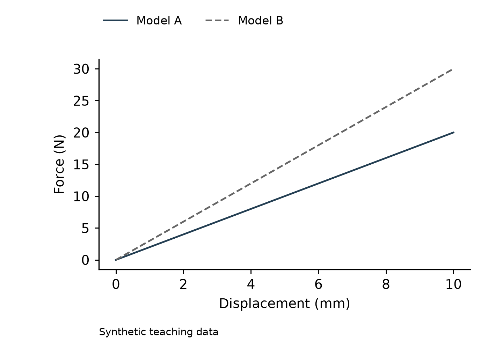

# 科研绘图 Skills

本仓库收录可安装的科研工作流 skill。当前提供 **scientific-figure-optimizer 0.1.3**：将带单位和来源说明的 CSV 曲线数据转换为 SVG、PDF、PNG，并交付输入快照、任务单、绘图代码、依赖说明和核查记录。

## 能做什么

- 共用线性坐标轴的1—3条曲线，保留全部输入数值、点数和点序。
- 按任务单授权调整尺寸、字体、颜色、线型和显示范围。
- 输出可编辑文字/路径的 SVG、带嵌入字体资源的 PDF、带尺寸/DPI信息的 PNG。
- 重新读取导出文件，核对SVG顶点、参考线、PDF页面和字体、PNG像素与DPI、必要文件及哈希。
- 将整次输出目录复制到其他位置，按其中的 REPRODUCE.md 独立重跑。

不会自动平滑、删点、排序、重采样、换单位或移动参考边界。来源真实性、统计合理性、科学结论、版式美感和期刊要求需要人工确认。**当前正式后端是 Python/Matplotlib；Origin 原生路线未通过验收，不在安装包内。**



## 快速开始

准备 Git 和 Python 3.12；私有仓库需要相应的 GitHub 访问权限。本次上传位于 scientific-figure-optimizer-v0.1.3 分支；PR合并到main后可省略下面的 --branch 参数。在 PowerShell 中运行：

```powershell
git clone --branch scientific-figure-optimizer-v0.1.3 https://github.com/zhilishiwubai/skill.git
cd skill/scientific-figure-optimizer
python --version
python -m venv .venv
.venv\Scripts\python.exe -m pip install -r requirements-lock.txt
.venv\Scripts\python.exe scripts/install_skill.py
```

安装器默认将资源放到 CODEX_HOME 下的 skills/scientific-figure-optimizer；未设置时使用用户目录中的 .codex。已有目标会被拒绝，更新前请先完整备份旧版。重新打开 Codex 会话以发现 skill。运行脚本时使用装好依赖的虚拟环境解释器。

先运行自带公开案例：

```powershell
.venv\Scripts\python.exe scripts/figure.py check examples/spring.json
.venv\Scripts\python.exe scripts/figure.py render examples/spring.json --out runs/my-first-figure
.venv\Scripts\python.exe scripts/figure.py verify runs/my-first-figure
```

每次使用全新输出目录。打开结果中的 figure.png、final-size.png 和 grayscale.png 检查裁切、遮挡、灰度线型、峰值与负值的可见性。自动检查通过不等于科学批准。

## 使用自己的数据

1. 准备带唯一表头的 UTF-8 CSV，保留原件；明确各列单位、来源、证据等级及使用权。
2. 复制 assets/brief-template.json，修改 input、列名、标签、单位、provenance、修改授权和验收问题。input 相对任务单所在目录解析；不要沿用与新数据不符的示例来源或公式。
3. 依次执行 check、render、verify，最后打开实际图件并请作者核对科学含义。
4. 交付整个输出文件夹；复制后按 REPRODUCE.md 重跑。自定义字体需要独立合法安装，并满足原字体哈希。

给 Agent 的请求示例：

> 使用 scientific-figure-optimizer 检查这份 CSV 和任务单，保留全部数值及点序，只执行获准的样式修改，在新目录交付 SVG/PDF/PNG、复现文件和核查记录，并列出仍需作者确认的问题。

> Use scientific-figure-optimizer to check this CSV and brief, preserve all values and point order, apply only authorized styling, and deliver SVG/PDF/PNG with reproduction files and an audit in a new directory. Identify questions requiring author review.

## 说明与验证记录

- [模块介绍与安装说明](scientific-figure-optimizer/README.md)
- [逐步使用流程](scientific-figure-optimizer/docs/WORKFLOW.md)
- [完整教程及异常示例](scientific-figure-optimizer/docs/TUTORIAL.md)
- [任务单字段与约束](scientific-figure-optimizer/references/task-contract.md)
- [0.1.3验证与限制](scientific-figure-optimizer/docs/VALIDATION-0.1.3.md)
- [修复状态](scientific-figure-optimizer/docs/RELEASE-0.1.3.md)
- [Origin当前状态](scientific-figure-optimizer/references/origin-assessment.md)
- [上传文件清单](UPLOAD_MANIFEST.json)与[文件哈希](RELEASE-SHA256SUMS.txt)

正式版本地43项测试通过，其中含使用既有原生PDF的只读检查。该PDF夹具没有打包；普通运行会明确跳过该可选项，其余42项可执行。需要重跑可选检查时，通过 SFO_NATIVE_TYPE3_PDF 显式指定相应合法夹具。不要把SKIP记作通过，也不要将字体资源检查解释为完整PDF标准合规。

## 隐私与许可

命令行绘图脚本没有上传输入的逻辑。输出快照会复制**完整CSV，包括未绘制的列**，来源和脚注也可能含私人信息。Agent打开文件或图件会将内容加入对话上下文；私有GitHub仓库也属于外部传输。共享前逐文件检查。

本仓库示例只使用自编CC0教学数据，无私人研究数据、机台原始数据、第三方Origin工程或独立字体文件。代码及说明采用[MIT许可](scientific-figure-optimizer/LICENSE)，教学数据许可见[示例许可](scientific-figure-optimizer/examples/LICENSE)。
