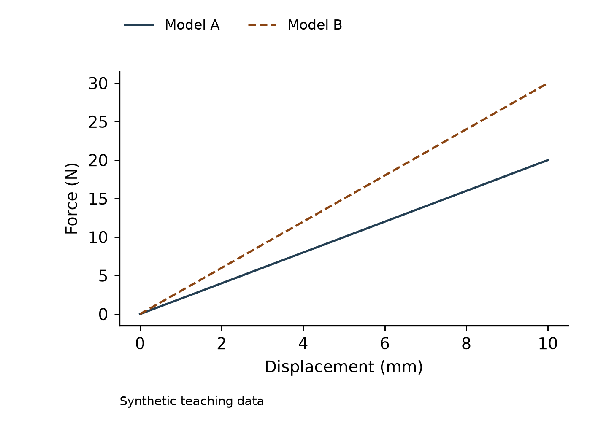
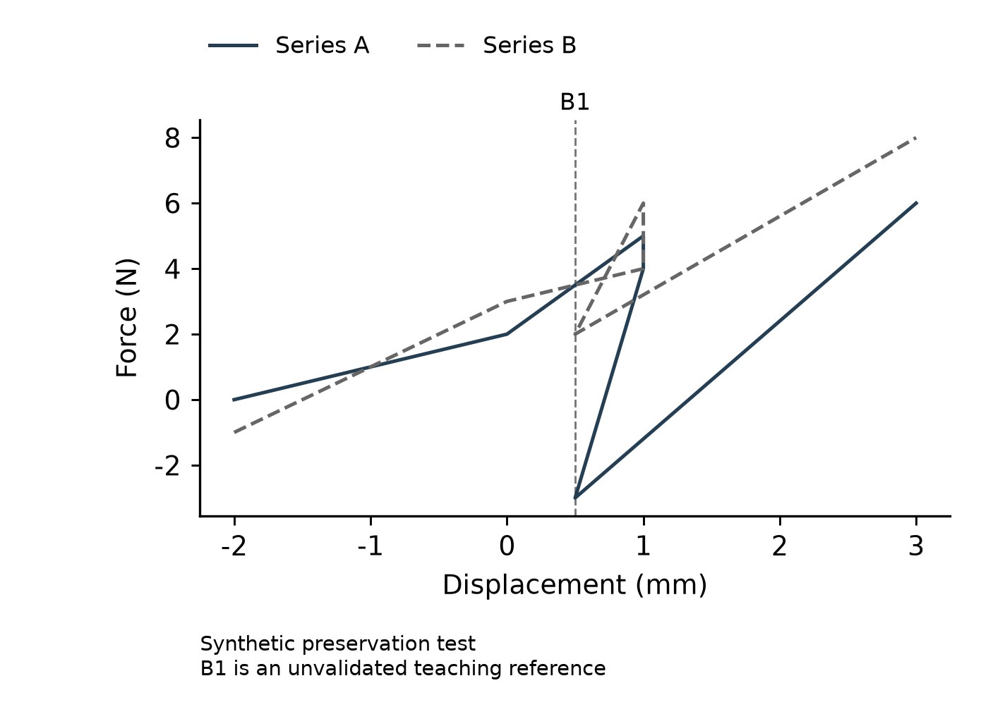
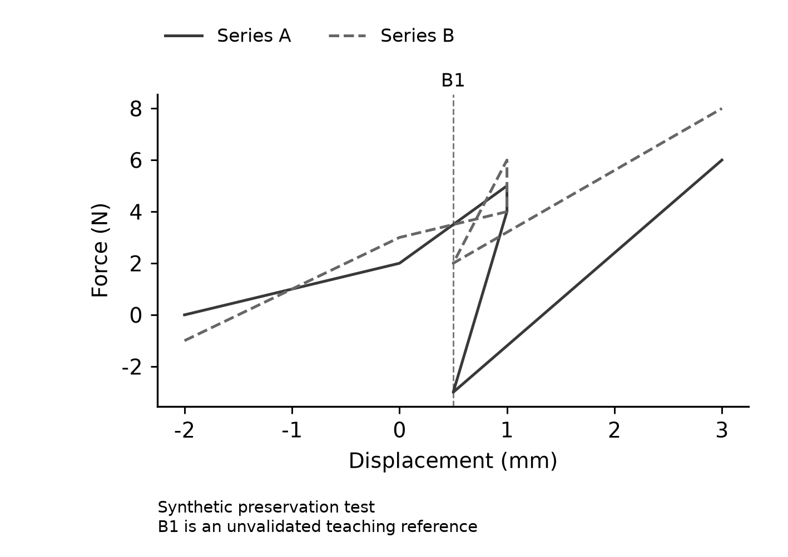
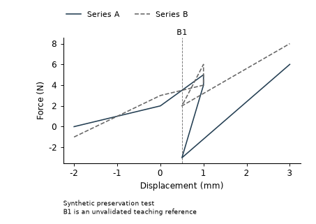
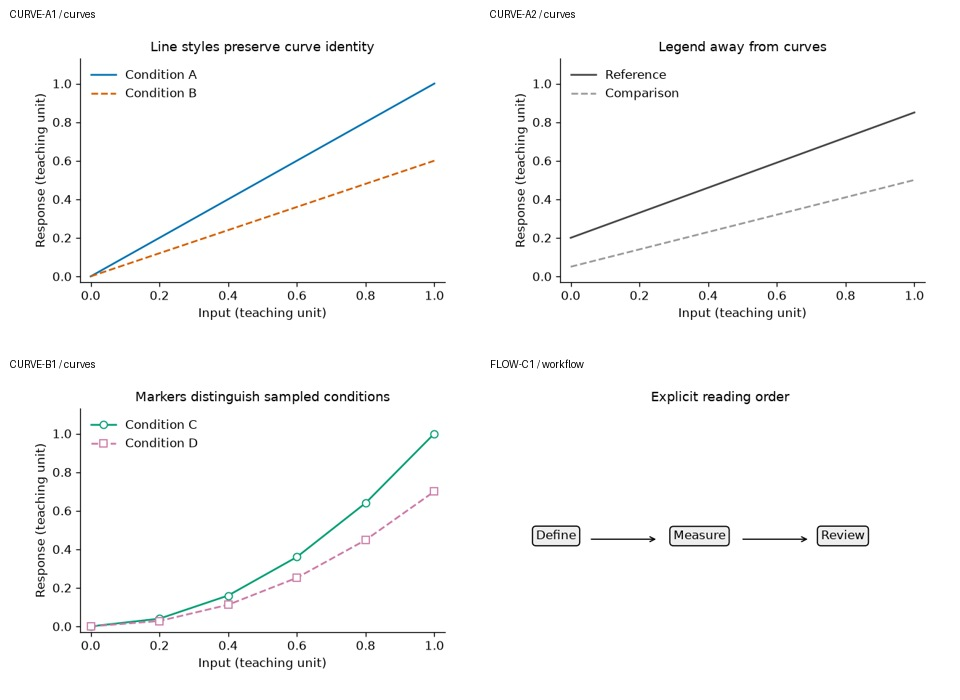

# 课程讲解图件素材

以下文件是验证过程中实际导出的图件或缩略总览，均为自编教学材料；**不是软件界面截图，也不是Origin原生工程编辑成功的证据**。原始文件逐字节复制，无裁切、重绘或生成式处理。

## 从CSV生成数据图

自编教学数据，规定斜率为2和3 N/mm；不是试验结果。

## 数据保真：负值、重复点与逆序

保留每条曲线6个点和原始顺序；B1是未验证的教学参考。

## 灰度下区分曲线

同一组数据保留实线/虚线编码；不据此宣称所有配色都通过灰度检查。

## 在最终尺寸检查可读性

本例为120×85 mm；核查标签、图例及脚注。

## 参考案例检索与阅读

四个自编夹具图，三张曲线经过实际查看；流程图保持UNREVIEWED。不是私人论文图库。

## 可直接使用的功能说明

本Skill通过本地案例检索、实际看图和规则提炼制定绘图方案，并通过确定性程序生成和核查CSV曲线。参考学习不是模型训练，图库不代替本任务数据。

Origin状态：作者根据代码审阅确认可用，本轮按作者要求停止进一步复验。安装包不新增Origin可执行适配器；作者确认、程序测试和科学批准分别记录。

代码/说明采用项目MIT许可，自编教学数据为CC0。图件不含私人论文、真实试验数据或个人界面信息。
